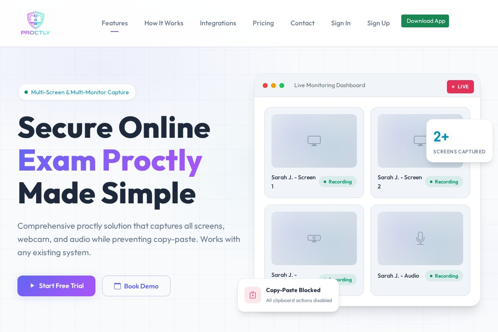
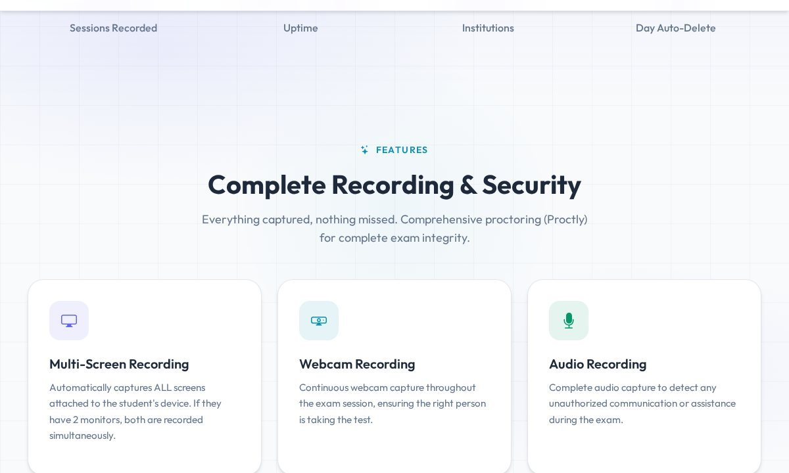
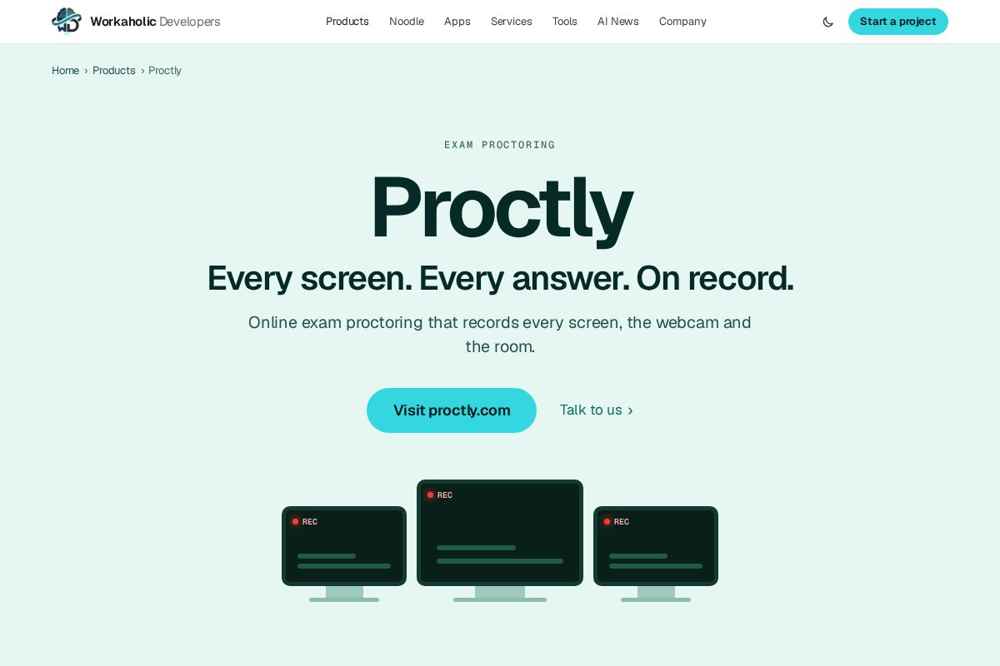

# Proctly

**Online exam proctoring that records every screen, the webcam and the room.**

> This is a public showcase repository. It describes the product and links to it; the source code is private.

- Product site: https://proctly.com
- Product page: https://workaholicdevelopers.com/products/proctly

## What it is

Proctly proctors online exams with a desktop app that records every attached screen, the webcam and audio, and blocks copy-paste. It works alongside any exam system and has one-click ClassTrack integration.

## Who it's for

Colleges and institutions running remote or online exams.

## Features

- **Every screen recorded.** All attached monitors are captured, not just the main one.
- **Webcam and audio.** Continuous camera and microphone recording for the whole exam.
- **Copy-paste blocked.** Clipboard blocking with logs of attempts, URLs visited and violations.
- **A real desktop app.** For Windows, macOS and Linux.
- **Privacy built in.** Per-student downloads, instant purge and automatic deletion after 30 days.
- **Works with ClassTrack.** One-click integration, student groups and an API for any other system.

## Screenshots

*Recording features*

*Proctly on workaholicdevelopers.com*

## Who builds it

Built by Workaholic Developers. [EduWeb Consulting](https://eduwebconsulting.com) delivers Proctly to colleges across Canada.

---

Built by [Workaholic Developers](https://workaholicdevelopers.com), a software company with teams in India and Canada. Questions or a project in mind: info@workaholicdevelopers.com
